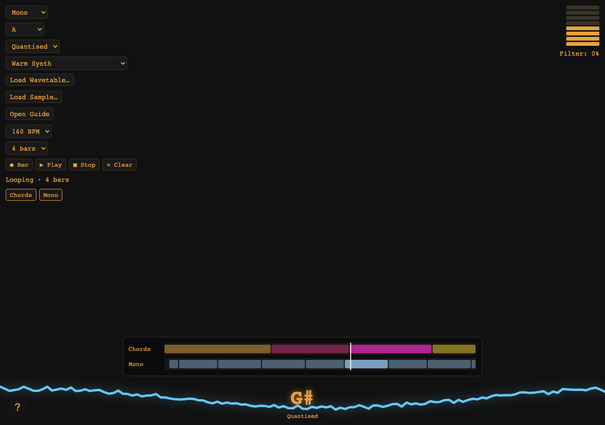
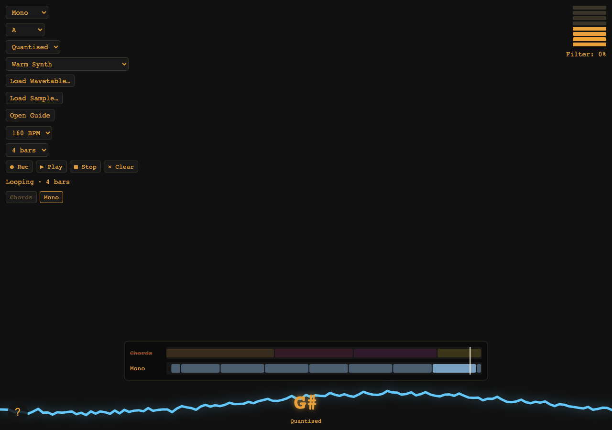

# Etherphone

**A contactless instrument you play in the air — built to be performed live and recorded in the same page.**

One hand shapes the harmony. The other shapes the expression. There is no keyboard,
no MIDI controller, no DAW, and nothing to touch — a webcam, two hands, and a
browser are the whole rig.

Etherphone is built on [Gesture Synth](https://github.com/ericwei97-cloud/gesture-synth)
by [Eric Wei](https://indecisiveeric.com), a camera-based instrument that turns hand
gestures into chords. The gesture language is his; the instrument layer, the voices,
and everything since are this project's. See [Credits](#credits).

## The idea

Etherphone sits between two instruments that solved different halves of the same
problem.

**From the theremin, it takes contactless, continuous expression.** Pitch and volume
are positions in space, not keys under fingers, so a phrase is a movement rather than
a sequence of presses. Nothing is struck; everything is shaped. That is what makes
the instrument feel like an instrument and not a remote control.

**From the [MiMu gloves](https://mimugloves.com/), it takes a vocabulary carried by
the hand itself.** A hand shape can mean a chord, a voicing, a mode, a transport
command. A performer should be able to run a whole set — change key, switch voice,
arm a loop — without walking back to a laptop.

**The third part is that it should be self-contained.** Capture, synthesis, looping,
and the take you post all belong in the page. No account, no upload, no second
application, no cable. The only permissions it asks for are the camera — and, once
voice lands, the microphone — and the audio never leaves the machine.

The long-term shape is a performance machine: one person, two hands, a full piece —
played live, looped, layered, and recorded as a file worth posting.

## Where it is now

Etherphone started as a **chorder**: a chord exists while a hand holds a shape and
stops when the hand drops. It is now becoming a performance machine. It has a second
voice (**Mono** — melody, lead, bassline), a real **clock**, and a **looper** that
records what the hands meant and plays it back as layers — a chord bed with a melody
over it — that can be dropped out and brought back mid-performance. Chords, Mono, and
every setting are reachable by gesture, without the mouse.

What is still missing is rhythm, the microphone, and a way to record a finished
performance to a file.

The gap is mapped, not guessed. The open RFCs describe six changes to the
instrument, plus two to what happens after it is played:

```
Wave 1  Control plane   hands drive the interface          RFCs #4, #8
Wave 2  The spine       musical modes + a shared clock     RFCs #7, #2
Wave 3  Layers          voice, tuning, percussion          RFCs #9, #11, #10
        Capture         a take you can actually post       RFC #12
```

| Wave                  | What it unlocks                                                                                        | Why it is in this order                                                                                                                                       |
| --------------------- | ------------------------------------------------------------------------------------------------------ | ------------------------------------------------------------------------------------------------------------------------------------------------------------- |
| **1 — Control plane** | Gesture-driven menu navigation (#4) and remappable gesture maps (#8)                                   | Every later feature adds a control. If the only way to reach one is a `<select>`, the stop-and-click problem gets worse with each wave.                       |
| **2 — The spine**     | A monophonic voice for melody, lead, and bass (#7), and the recorder/looper with a real transport (#2) | The looper owns tempo and time. The mono voice forces the app to stop assuming that "musical intent" means "a chord". Everything after this is built on both. |
|                       | _Both landed: Mono (#7) and the looper with its shared clock and layers (#2)._                         |                                                                                                                                                               |
| **3 — Layers**        | Microphone looping (#9), tuned voice loops (#11), and percussion (#10)                                 | These are layers on the spine: same clock, same loop windows, same gesture control. Designing them against three separate clocks would be a mistake.          |
| **Capture**           | Render a performance — audio, and ideally the video overlay — to a file ready to post                  | The thing that makes it "perform into recording". It taps the master bus, so the loops, voice, and drums of the waves above arrive in the same mix for free.  |

The umbrella issue is [#1, "Etherphone as a performance machine"](https://github.com/therebelrobot/etherphone/issues/1).
The RFCs are deliberately written as _requests for comments_ — a problem, a direction,
and the questions worth arguing about — not as implementation-ready specs. Comments
and disagreements are wanted.

## Play it

**https://github.aster.hn/etherphone/**

Allow camera access when prompted, then hold up a hand. Camera access requires a
secure context, so use that `https://` URL — the plain-HTTP form of the same host
will load the app but cannot reach the camera.

## Features

**Today**

- Left hand chooses the chord and, by tilt, whether it is major or minor
- Right hand chooses the voicing and the expression
- A picker of gesture maps — Classic, Triad, and Pentatonic — remembered between visits
- A **Mono** mode where the left hand's height plays a single note: melody, lead, or bassline
- Three mono styles — quantised, glide, and harp — so a sweep up the frame is a scale run
- A **gesture menu**: close both hands to fan one out around your hand, push out to point, dwell to choose. It reaches the key, the instrument, the transport, and the layers too
- A **looper**: record a chord bed, switch to Mono, record a melody over it — and drop either layer out and back in without stopping
- A picker of instruments: oscillators, wavetables, and sampled sounds
- Load your own wavetables and samples as new instruments
- Real-time hand tracking with MediaPipe, synthesis with the Web Audio API
- Runs entirely in the browser; a static build is the whole application

**Next, in the order the RFCs argue for**

- Build your own gesture map, by gesture rather than by mouse
- Capture the microphone and loop voice as a layer
- Tune a captured voice loop to the key without changing its timing
- Percussion: live hits, a step grid, and possibly a small pattern notation
- Record a finished performance — audio, and ideally the video overlay — to a file ready to post

## Built With

- TypeScript
- MediaPipe Hand Landmarker
- Web Audio API
- Vite

## Getting Started

```bash
npm install
npm run dev
```

Open the dev server URL, click the start overlay to grant audio, and allow camera
access. The camera only works on `localhost` or over HTTPS — browsers block
`getUserMedia` on plain HTTP.

### Scripts

| Script              | What it does                          |
| ------------------- | ------------------------------------- |
| `npm run dev`       | Vite dev server with hot reload       |
| `npm run build`     | Typecheck, then build to `dist/`      |
| `npm run preview`   | Serve the production build locally    |
| `npm run typecheck` | `tsc --noEmit`                        |
| `npm run lint`      | ESLint (and `lint:fix` to autofix)    |
| `npm run format`    | Prettier (and `format:check` for CI)  |
| `npm test`          | Vitest, single run (and `test:watch`) |
| `npm run coverage`  | Vitest with a V8 coverage report      |
| `npm run samples`   | Regenerate the bundled sample WAVs    |

## Architecture

The instrument is a pipeline. Each stage is its own module, and only `src/app.ts`
knows about all of them at once:

```
camera ──▶ landmarks ──▶ musical intent ──▶ stabiliser ──▶ audio
                                                   └────▶ visuals
```

```
src/
  main.ts                  Entry point: mount the app, report startup failures.
  app.ts                   The only module that wires the layers together. Owns the
                           per-frame state and the requestAnimationFrame loop.

  types.ts                 Shared vocabulary (Hand, ChordNumeral, ChordState, ...).
  types/globals.d.ts       Ambient declaration for Safari's prefixed AudioContext.

  config/
    constants.ts           Cross-cutting tunables: timing windows, camera settings,
                           tilt travel, filter response.
    music.ts               Music-theory tables: scales, semitone offsets, palette.

  vision/
    camera.ts              getUserMedia, resolving when the video has metadata.
    hand-tracking.ts       MediaPipe HandLandmarker construction.
    gestures.ts            Landmark interpretation: finger extension, tilt, volume,
                           chord classification. Pure functions, no DOM.
    overlay.ts             Cover-crop maths and canvas frame drawing.

  music/
    harmony.ts             Roman numeral + tonic -> note names and frequencies.
    mono.ts                The mono voice's pitch mapping: height -> scale degree,
                           and the quantised, glide, and harp readings of it.
    take.ts                A recorded performance, and how its intent resolves back
                           into frequencies against the key in play.
    recorder.ts            Capturing intent into a take: changes only, on a grid.
    looper.ts              The layers: arming, recording, phase, playback, mute.
    gesture-map.ts         The gesture vocabulary as data: hand shapes as bitmasks,
                           and the Classic, Triad, and Pentatonic presets.
    stabilizer.ts          Holding a reading before committing to it. The chord
                           path and the gesture menu both use DwellStabilizer.
    voicings.ts            The four right-hand voicings per mode, each with a label
                           and a note selector, so readout and audio cannot drift.

  audio/
    transport.ts           The shared clock: tempo, bar lines, and the loop's length,
                           measured in beats against the AudioContext's clock. Pure,
                           so the timing maths is testable without a browser.
    synth-engine.ts        Voice -> waveshaper -> lowpass filter -> master gain.
                           Owns the shared chain and the AudioContext; the notes
                           themselves belong to whichever voice is loaded. A layered
                           loop is a second engine joined to the same context.
    voice.ts               The Voice interface, the instrument registry, and the
                           frequency key voices use to skip unchanged frames.
    wavetable.ts           Harmonic spectra: the bundled tables and the analysis
                           of a loaded cycle. Pure arithmetic.
    sampler.ts             Playback-rate maths, the loop crossfade, and the list
                           of bundled recordings. Pure arithmetic.
    user-voices.ts         Turns a file you loaded into a registrable instrument.

    voices/
      bank.ts              Shared lifecycle for one-oscillator-per-note voices.
      oscillator-voice.ts  Plain waveforms, one instrument per shape.
      wavetable-voice.ts   A spectrum, played through a PeriodicWave.
      sampler-voice.ts     One recording pitched across the keyboard.
      index.ts             Registers the built-in instruments, in picker order.

  visuals/
    energy.ts              The jittering "energy ribbon" behind the chord readout.
    loop-tracks.ts         The loop's layers as lanes along the bar, with a playhead:
                           what is on the loop, and which parts are dropped out.

  ui/
    dom.ts                 The full list of ids and classes the app expects.
    hud.ts                 Chord, quality, and filter readouts.
    volume-meter.ts        The eight-segment volume meter.
    gesture-guide.ts       The cheat sheet, rendered for the mode in play: the
                           active map's degrees, or the mono voice's pitch ladder.
    radial-menu.ts         The gesture menu: the ring's geometry and the list's,
                           hit-testing for both, and the fan-out drawing.
    menu-controller.ts     When the menu opens, what it highlights, and what commits.
    help-modal.ts          The "how to play" modal, filtered to the mode in play.
    start-overlay.ts       The click-to-enable-audio gate.
```

The RFCs each name the modules they would add, and some of them are here already —
`src/audio/transport.ts` for the shared clock, `src/music/recorder.ts`, `take.ts` and
`looper.ts` for the layers. Others are still to come: a mic voice in
`src/audio/voices/`, and drum kits. The point of the layout is that those are
additions, not rewrites: the `Voice` seam already made a wavetable and a sampler
registry entries, the `Transport` is now the one clock percussion and voice looping
will read, and the looper's tracks were built as layers so a mic loop is one more.

### How the gestures map to music

The instrument has two **modes**, chosen in the picker at the top of the stack. The
split is deliberate and worth remembering: the **left hand is the "which notes"
hand** — harmony in Chords, pitch in Mono — and the **right hand is always the "how
it sounds" hand**, with the same jobs in both modes.

**Left hand — chord** (Chords mode, the Classic map)

| Input                 | Result           |
| --------------------- | ---------------- |
| 1–5 fingers           | Scale degree I–V |
| Index + pinky         | VI               |
| Index + pinky + thumb | VII              |
| Tilt inward / outward | Major / minor    |

**Left hand — pitch** (Mono mode)

| Input  | Result                                          |
| ------ | ----------------------------------------------- |
| Height | A single note: higher in the frame is higher up |

**Right hand — voicing and expression**

| Input                 | Result                                          |
| --------------------- | ----------------------------------------------- |
| 1–4 fingers           | Root position, 1st inversion, 7th, dominant/dim |
| Thumb in / out        | Drop the voicing an octave / leave it           |
| Tilt inward / outward | Close the filter / open it                      |
| Height                | Louder the higher the hand                      |

The chord hand feeds `ChordStabilizer`, which requires a new chord to hold for 100ms
before it is committed and tolerates a 50ms dropout. That is why the instrument does
not flicker between chords when MediaPipe loses a hand for a frame. Mono mode reads
the frame directly: there is no chord to stabilise, because the note is simply
wherever the hand is.

**The cheat sheet follows the mode**, because the same hand does different things in
each. In Chords mode it lists the active gesture map's degrees and the shape that
selects each; in Mono mode it is a ladder of the notes the pitch hand can reach,
highest at the top so it reads the way the frame does. The `?` guide is filtered the
same way — a guide that describes the hand you are not playing is worse than none.

#### Chords mode

The left hand's vocabulary is a **gesture map**, chosen in the picker below the key.
Three presets ship; the choice is remembered between visits.

- **Classic** — the inherited vocabulary, and the default, so existing players'
  hands keep working unchanged.
- **Triad** — three chords only, I, IV, and V, on one to three fingers. Four or
  more fingers play nothing, so a degree you are not using cannot fire.
- **Pentatonic** — the five pentatonic degrees on one to five fingers. It needs no
  rock sign, which is also the shape some players cannot make.

This vocabulary is inherited from Gesture Synth, and the Classic map is a _diatonic
seventh-chord_ vocabulary: it assumes seven degrees and a hand that can make a rock
sign. [RFC #8](https://github.com/therebelrobot/etherphone/issues/8) made the mapping
**data** — a hand shape is a bitmask over the five fingers, and a map is a table from
shape to scale degree — so a player can work in a pentatonic idiom, choose only the
three chords they want, or reach them with shapes their hands actually make. The
presets ship; a gesture-driven editor for building custom maps is the remaining half
of that RFC, and waits on the gesture menu ([#4](https://github.com/therebelrobot/etherphone/issues/4))
so it can be used without a keyboard.

#### Mono mode

One note at a time, chosen by the left hand's height and quantised to the key, over a
range of `MONO_OCTAVE_SPAN` octaves. The pitch hand's position is read three ways:

| Style         | What it does                                                                               |
| ------------- | ------------------------------------------------------------------------------------------ |
| **Quantised** | Snaps to the nearest scale degree and holds it; moving the hand steps to the next.         |
| **Glide**     | Slides continuously between degrees, retuning the sounding note rather than restarting it. |
| **Harp**      | Plucks a fresh note each time the hand enters a degree, so a sweep plays a run.            |

Harp is the Omnichord's strum plate: the frame is a span of in-key notes, and moving
through them plays them in sequence. A harp sweep is why the mono voice has its own
ascending scale (`MONO_SCALE_SEMITONES`) rather than reusing the chord table's
`DEGREE_SEMITONES` — the latter tunes degree VII a semitone _below_ the tonic, which
is right for a chord rooted on the leading tone but would drop an octave at every
seventh step of a run.

Glide is the one place the `Voice` seam needed extending. `play()` rebuilds its
oscillators whenever the frequencies change, which is right for a chord and wrong for
a glide, so `Voice` gained an optional `retune()` that slides a sounding note instead.
A voice that cannot retune falls back to `play`, so a glide on such an instrument
steps rather than going silent.

#### The gesture menu

Every setting used to be a `<select>`, which meant dropping your hands and reaching for
a mouse mid-performance — and each feature added since has added another one. Close
**both hands** for a moment and a radial menu opens around the hand:

- **Both hands closed** opens it. That gesture is safe precisely because it is already
  a silent shape in either mode — a closed chord hand chooses no chord and a closed
  voicing hand sounds nothing — so the menu can never be opened at the cost of a note.
- **The menu is anchored to the hand**, not to the middle of the screen, and it stays
  where it opened. That is what makes it reachable: there is nowhere to travel to,
  because the hand is already at the centre. It also means the hand starts _inside the
  dead zone_, so nothing is selected — and no dwell begins — until it is deliberately
  pushed outwards. A menu in a fixed place makes reading it a race against the dwell,
  which is exactly what the first version got wrong.
- **Push outwards to point.** The selection is by _direction_, not proximity, so a
  coarse hand does not have to land on the option. A dead zone in the middle means the
  centre is a neutral spot to retreat to.
- **Dwell to commit.** A ring fills around the option; when it closes, the choice is
  applied and the menu shuts.
- **Close both hands again to dismiss it.** The engage gesture is a toggle, so bailing
  out is the same movement as opening. There is no pointer to click away with, so
  waiting out the idle timeout is not an escape; the menu says so on screen. The
  gesture has to be released in between, so a passing fist cannot dismiss it by
  accident.
- **The options fan out.** Each one flies out of the anchor and settles onto its spot,
  a little after the one before it, so the menu arrives as a wave rather than all at
  once. Each is stretched along the direction it is travelling while it is in flight
  and rounds off on arrival, and each overshoots its resting spot slightly before
  springing back. The whole fan-out is over well inside `dwellMs`, so it can never eat
  into the time the player has to choose.
- **Idling times it out** after a few seconds with the hand off every option.

The anchor is nudged back on screen when the hand is near an edge, so an option is never
off-screen — where it could still be selected by direction but could not be seen.
Because that nudge can leave the hand sitting off-centre, a deliberate move is required
before anything is selected too; in the ordinary case the dead zone already covers it,
and the two coincide.

Opening the menu silences the instrument: it is a deliberate pause, not an overlay you
play through.

The menu carries the vocabulary for the current mode — the gesture maps in Chords mode,
the mono styles in Mono mode — **plus a switch to the other mode**, because otherwise
the two sets would be mutually unreachable by gesture. The switch keeps the menu open,
so the ring re-renders in place and picking the other vocabulary is one continuous
movement rather than two trips through the menu.

#### Two clusters, one hand each

The menu used to mix two kinds of thing in one ring: values you can choose, and
doors into somewhere else. "Classic" is a choice _in_ the menu; "Key" is a way
_out_ of it, and they were drawn identically. So each kind now has its own cluster
and its own hand:

- the **left hand picks the menu** you are in — Vocabulary, Key, Instrument, Settings;
- the **right hand picks the option** within it.

Both are live at once, so changing menu and changing option are one movement rather
than two trips. Each cluster is anchored to its own hand, so each hand starts inside
its own dead zone and neither can select anything by resting.

The menus cluster is drawn to read as a way elsewhere, in **three ways at once**
rather than colour alone — colour fails for colour-blind players and washes out over
a busy camera frame. It takes a cool accent against the options' gold, a chevron
before each label, and a dashed outline. The menu in force is filled, so you can see
where you are.

#### One hand, in stages

With one hand the same two levels happen in turn rather than at once: open the menu,
hold on a menu, then hold on an option. After a menu is chosen the options are
**anchored where that menu item was** — the hand is already out there, so it lands in
the middle of the new cluster and cannot select something by simply not moving. The
cluster waiting its turn is drawn faded, so it is clear which one the hand is on.

It is a setting in **Settings**, which is also where the mode lives now: the mode is
not a value of the vocabulary, it decides which vocabulary there is.

#### The key and the instrument open a list

A ring stops working somewhere around eight options: twelve keys would need more
circumference than the circle has. So the Key and Instrument menus open as a **list**
down the canvas instead:

- the hand's **height** picks the row, so the choice is one dimension rather than two,
  and a hand does not have to be over the label horizontally;
- the dwell fills the row from the left, and commits the same way it does in the ring;
- the rows arrive as a wave too, on a shorter stagger, since there are more of them.

Nothing is reachable only by mouse now except the two file pickers, which are the
operating system's dialog and cannot be anything else.

The hold-before-commit rule is shared. `DwellStabilizer` is the general shape — wait for
a value to be steady, then act on it — and both the chord path and the menu use it.
`ChordStabilizer` is that plus the tolerance for MediaPipe dropping a hand for a frame.
The RFC expected the looper's quantised arm to reuse it; in the end that arm quantises
to the transport's bar lines instead, which is the stronger guarantee — a loop starts on
the grid, not merely after a pause.

#### The looper

Closing both hands opens the menu, and **Transport** holds the looper: **Record**,
**Play**, **Stop**, **Clear**. Recording arms the looper and begins on the next bar
line, so the loop lands in time rather than wherever your hands happened to be. Play a
phrase; after the chosen number of bars it starts looping.

What it records is **intent**, not audio — the chord that was held, or the degree the
melody reached, stamped with where in the bar it began and how loud it was. That is a
handful of numbers rather than a waveform, and it replays through the same harmony
functions the live instrument uses, so a take sounds like the take. It also means
changing the key **transposes the loop**, in step with everything else.

Each mode records into its own **layer**: record in Chords, switch to Mono, record
again, and the two play together. The **Layers** menu toggles each one in and out
(and the buttons under the transport do the same by mouse) — which is the move that
makes a looper something you can _perform_ with rather than just listen to.



The lanes are the loop: one per layer, its notes as blocks along the bar, and a
playhead sweeping across. A dropped-out layer goes faded and struck through, so the
arrangement reads at a glance.



Under it all is `Transport` (`src/audio/transport.ts`): tempo and bar lines, counted in
beats against the `AudioContext`'s own clock rather than the frame loop, so the grid
does not drift when inference is heavy. The looper owns no clock of its own, and
neither will the percussion sequencer — that is the point of it being its own module.

### Instruments

The picker lists every instrument, and each one is a **voice**: a small module
that turns a list of frequencies into sound. `SynthEngine` owns the shared chain —
`voice → waveshaper → lowpass filter → master gain` — and the `AudioContext`. A
voice owns only its own nodes.

```
SynthEngine.playNotes(freqs) ──▶ voice.play(freqs) ──▶ waveshaper ──▶ filter ──▶ gain
```

`playNotes` is the whole interface. It never learns what kind of voice it is
talking to, so swapping an oscillator for a sampler is a registry lookup.

Three kinds ship in the box:

| Kind       | What it does                                                                      |
| ---------- | --------------------------------------------------------------------------------- |
| Oscillator | Plain waveforms: Warm, Bright, and Retro Synth.                                   |
| Wavetable  | A single cycle written as harmonic coefficients, played through a `PeriodicWave`. |
| Sampler    | One recording pitched across the keyboard, looped with a crossfaded seam.         |

**Load Wavetable…** reads a `.wav` holding a single cycle and rebuilds it as a
wavetable; **Load Sample…** reads any recording and pitches it across the
keyboard. Both register a new instrument and switch to it, down the same path the
built-in ones take — the picker cannot tell them apart.

Two caveats about loaded files, both deliberate:

- A wavetable file must be **one cycle**. A file holding many cycles analyses as a
  smeared spectrum, not the timbre you recorded.
- A sample's pitch is **assumed to be A2 (110 Hz)**, since nothing here detects
  it. A recording at another pitch is heard transposed by the interval between the
  two. [RFC #11](https://github.com/therebelrobot/etherphone/issues/11) is the answer
  to this for captured voice: detect the fundamental, then transpose without
  changing duration.

The bundled samples are generated rather than sourced: `npm run samples` writes
them into `public/samples/` from `scripts/generate-samples.mjs`, so the repository
owns their licence and the recipe is reviewable. The starter drum kit proposed by
[RFC #10](https://github.com/therebelrobot/etherphone/issues/10) should be generated
the same way.

### Adding to it

- **A new instrument:** implement `Voice` — or reuse `OscillatorBank` — and register a `VoiceDefinition` in `src/audio/voices/index.ts`. It shows up in the picker; nothing else changes.
- **A new wavetable:** add an entry to `WAVETABLE_PRESETS` in `src/audio/wavetable.ts`.
- **A new sample:** drop a `.wav` into `public/samples/` and add it to `BUNDLED_SAMPLES` in `src/audio/sampler.ts`.
- **A new voicing:** add one entry to `MAJOR_VOICINGS` or `MINOR_VOICINGS` in `src/music/voicings.ts`. The label and the notes come from the same object.
- **A new key:** add its tonic frequency to the `<select id="keySelect">` in `index.html` and its scale to `MAJOR_SCALE` in `src/config/music.ts`.
- **A new synth stage:** insert it into the shared chain in `SynthEngine.ensureContext()`; the graph order is documented there.
- **A new gesture:** add a pure function to `src/vision/gestures.ts` and cover it in `gestures.test.ts`.

## Self-Hosting with Docker

The repo publishes a multi-arch (amd64 + arm64) image to GitHub Container Registry:

```bash
docker run -p 8080:80 ghcr.io/therebelrobot/etherphone:latest
```

Or with Compose:

```bash
docker compose up -d
```

Then open <http://localhost:8080>.

> **Camera access requires a secure context.** `localhost` counts as secure, so the command above works. On any other hostname you must serve the container over HTTPS and proxy to it — put Caddy, Traefik, or a cloud load balancer in front, or terminate TLS inside nginx.

To build the image yourself:

```bash
npm run docker:build
```

> **First publish:** a new GHCR package starts private. On the package page, go to Package settings → Change visibility → Public, otherwise the compose file will fail to pull anonymously.

Verify a published image:

```bash
docker buildx imagetools inspect ghcr.io/therebelrobot/etherphone:latest
gh attestation verify oci://ghcr.io/therebelrobot/etherphone:latest --owner therebelrobot
```

## Deployment

| Target           | Workflow                                        | Required setup                                                                                                                                                                  |
| ---------------- | ----------------------------------------------- | ------------------------------------------------------------------------------------------------------------------------------------------------------------------------------- |
| GitHub Pages     | `.github/workflows/deploy-pages.yml`            | Settings → Pages → Source = "GitHub Actions". The build is given a `/<repo>/` base path automatically.                                                                          |
| Cloudflare Pages | `.github/workflows/deploy-cloudflare-pages.yml` | Create a Pages project, set `CLOUDFLARE_API_TOKEN` + `CLOUDFLARE_ACCOUNT_ID` secrets, and a `CLOUDFLARE_PAGES_PROJECT` variable. The job is skipped until that variable exists. |
| GHCR image       | `.github/workflows/ghcr-publish.yml`            | Nothing — uses the built-in `GITHUB_TOKEN`.                                                                                                                                     |

Any other static host works too — the build output in `dist/` is plain HTML, CSS, and JS. [Vercel](https://vercel.com), for example, auto-detects Vite and serves `dist/`.

CI (`.github/workflows/ci.yml`) runs formatting, linting, typechecking, tests, and a build on every push to `main` and every pull request.

To cut a release (which tags and triggers the multi-arch image build):

```bash
npm run release:patch   # or release:minor / release:major
```

## Credits

**Gesture Synth** — the original instrument, its gesture language, and the musical
design this project inherits — is by [Eric Wei](https://indecisiveeric.com):

- https://github.com/ericwei97-cloud/gesture-synth
- 🎥 The Gesture Synth tutorial on Instagram: https://www.instagram.com/p/DbH1BACxNCG/

Etherphone's own additions are the instrument layer and its registry, the picker,
the wavetable and sampler voices, the runtime loading of your own files, and the
bundled sample generator.

**Design lineage, not code lineage.** The _theremin_ (Léon Theremin, 1920) is the
reason this instrument is played without contact, and the _MiMu Gloves_ (Imogen Heap
and team, from 2010) are the reason it treats a hand shape as a word. Neither
project's code, hardware, firmware, or assets are used here. See the next section.

## Naming, provenance, and legal

Etherphone is a name with a history. **"Etherphone"** — alongside _ætherphone_ and
_thereminophone_ — was one of the names used for Léon Theremin's instrument in the
1920s before "theremin" settled. The name is used here as a deliberate link to that
lineage, not as a claim on anyone else's mark.

**The theremin is public domain.** Theremin's core US patent, US 1,661,058, _Method
of and apparatus for the generation of sounds_, was filed in 1925, granted in 1928,
and expired in 1945, so the design has been free to build for eight decades. No
patent or trademark litigation over the instrument turned up in the research for
this project, and "theremin" is used generically by dozens of independent makers.
Brand names such as Moog's _Etherwave_, _Thereminvox_, and RCA's marks belong to
their owners and are not used here. Etherphone is also not a theremin electrically:
it tracks hands with a camera and synthesises with the Web Audio API, rather than
sensing capacitance in an antenna circuit.

**MiMu is an independent company, and this project is not affiliated with it.**
Mi.Mu Gloves are a commercial wearable instrument made by Mi.Mu Gloves Limited (UK
company 10983859), conceived by Imogen Heap and developed from 2010. Etherphone is
not affiliated with, endorsed by, sponsored by, or compatible with MiMu, and it does
not copy their gloves, sensors, firmware, software, or trade dress — it is a
camera-based instrument with no wearable hardware. _MiMu_, _Mi.Mu_, _Glover_, and
_Gliss_ are their marks; they appear here only as a descriptive reference to the
design lineage, and no product name, package name, domain, logo, or module name in
this repository uses them. No MiMu-assigned patents surfaced in the patent searches
run for this project, and no litigation involving them surfaced in the news
searches; that is an absence of evidence, not a clearance opinion.

**The binding licence is Gesture Synth's.** Etherphone is a derivative work of
Gesture Synth and carries its non-commercial terms. That is the licence most likely
to constrain what you do with this code — not the theremin, and not MiMu. Playing
your own music on Etherphone and posting the recording is fine. Selling the
application, running it as a paid service, or shipping it inside a paid product needs
permission from Eric Wei, the author of Gesture Synth.

**Non-commercial, permanently.** Etherphone is not a product and will not become
one. It will not be sold, ad-supported, paywalled, or offered as a paid hosting
tier, and no commercial licence will be sought for it. That is a project commitment
on top of the inherited licence, not a stage it is passing through. Forks are
welcome under the same terms.

None of the above is legal advice; read [LICENSE](./LICENSE) yourself. Because the
project is non-commercial by design, the trademark position is the ordinary one for
a free project: describe the lineage, never imply endorsement, and keep other
people's marks out of this project's name, logo, domain, and package names.

## License

Etherphone is a derivative work of Gesture Synth, so it carries the same terms:
free to use, modify, and share for personal, educational, and non-commercial
purposes, with credit to the original. It is not for commercial use — selling it,
or shipping substantial portions of it in a paid product, needs permission from
the author of Gesture Synth. Etherphone is, and will remain, a non-commercial
project.

See [LICENSE](./LICENSE) for the full text.
